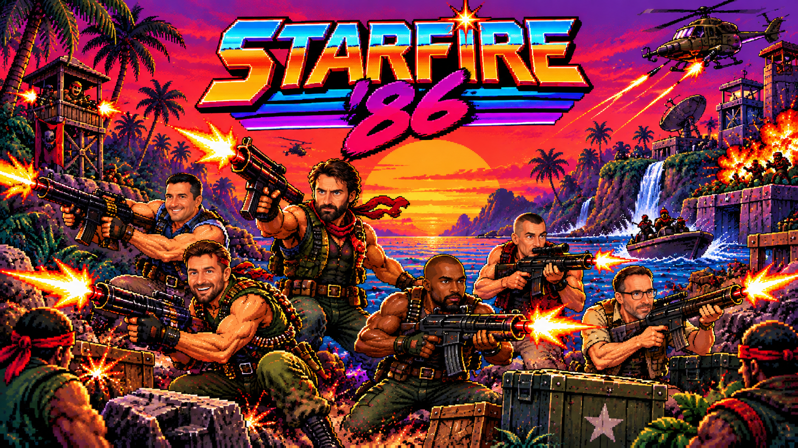
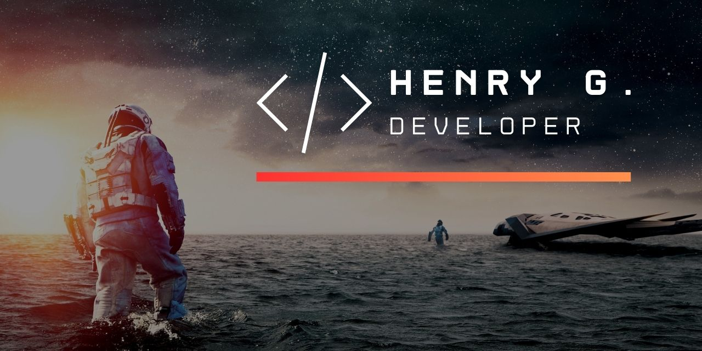

<h1 align="center">
  
</h1>

<p align="center">
  <b>Sparatutto arcade verticale in stile anni '80</b><br>
  Livelli infiniti, boss a fasi, power-up, combo e classifica — giocabile da desktop e mobile.
</p>

<p align="center">
  <a href="https://starfire.henrydev.it/"></a>
  
  
</p>

<div align="center">
  
</div>

## 🚀 Panoramica

**STARFIRE '86** è un omaggio ai cabinati arcade degli anni '80: piloti un caccia stellare, attraversi settori dello spazio sempre diversi, affronti ondate di nemici e **boss giganteschi**, raccogli power-up e cerchi di scalare la classifica.

Il gioco è **100% front-end** (HTML5 Canvas + JavaScript puro): gira nel browser, si adatta a schermo intero su mobile e viene servito come sito statico dietro nginx/Cloudflare con **deploy automatico** ad ogni push.

🌐 **Gioca Online**: [https://starfire.henrydev.it/](https://starfire.henrydev.it/)

## 🎮 Caratteristiche Principali

<picture>
  <source media="(prefers-color-scheme: dark)" srcset="https://raw.githubusercontent.com/abozanona/abozanona/output/galaga-contribution-graph-dark.svg">
  <source media="(prefers-color-scheme: light)" srcset="https://raw.githubusercontent.com/abozanona/abozanona/output/galaga-contribution-graph.svg">
  
</picture>

### Gameplay Arcade
- Sparatutto verticale a scorrimento con **livelli infiniti** e difficoltà progressiva
- **Boss a fasi**: ad ogni livello un boss diverso che a metà vita entra in **FASE 2** (attacchi più aggressivi)
- **Continua** in stile arcade (gettoni/crediti) e partita che riparte dal punto in cui sei morto
- Difficoltà bilanciata e progressiva, pensata per il gioco da mobile

### 👾 Nemici & Boss
- Nemici base, **corazzati**, **in picchiata/kamikaze**, **che sparano** e **a zig-zag**
- **4 tipi di boss** con pattern, movimento e colori distinti:
  - **SENTINELLA** — colpi mirati (+ anelli dai livelli alti)
  - **POLIPO** — anello completo rotante
  - **ARTIGLIERE** — spirale a 3 bracci
  - **RAGNATELA** — ventaglio rapido + anello periodico

### 🌌 Ambientazioni Spaziali
Sei scenari a tema fantascientifico che ruotano ad ogni livello, con **prospettiva planetaria** (orizzonte curvo, pianeti lontani, nebulose):

| Livello | Ambientazione | Scena |
|---|---|---|
| 1 | **ORBITA** | pianeta all'orizzonte + pianeta blu e luna |
| 2 | **LUNA GHIACCIATA** | superficie ghiacciata + pianeta con anello + neve cosmica |
| 3 | **GIGANTE GASSOSO** | gigante con bande e alone atmosferico |
| 4 | **PIANETA ALIENO** | pianeta verde + spore luminose |
| 5 | **NEBULOSA** | nubi colorate + pianeti lontani |
| 6 | **PIANETA INFERNO** | pianeta in fiamme con crepe di lava |

### ⚡ Power-Up
Raccogli i bonus per ottenere abilità temporanee o permanenti:
- **P** — Potenzia l'arma (fino a 5 colpi)
- **B** — Bomba aggiuntiva (colpisce tutti i nemici a schermo)
- **S** — Super missili
- **⚡** — Velocità temporanea
- **H** — **Scudo** (invulnerabilità temporanea)
- **R** — **Rapid Fire** (cadenza di tiro doppia)
- **M** — **Magnete** (attira i bonus)
- **♥** — Vita extra (1UP)

Ogni effetto attivo è mostrato con un indicatore a schermo.

### 🔥 Combo & Moltiplicatore
- Uccisioni consecutive aumentano un **moltiplicatore** (x2 → x5)
- Si azzera quando vieni colpito → premia il gioco aggressivo e preciso

### 📱 Controlli Mobile
- **Joystick virtuale flottante** (appare dove tocchi) con puntamento analogico
- Pulsanti **FIRE** e **BOMB** comodi per il pollice
- Pulsanti **Pausa** e **Schermo intero**
- **Vibrazione** (haptic) su colpi ed esplosioni
- Inserimento del **nome giocatore** con la tastiera del telefono
- Layout **a schermo intero**, controlli semitrasparenti sopra l'area di gioco

### 🏆 Punteggi & Classifica
- **Classifica Top 10** e record personale, salvati in locale
- Nome giocatore personalizzabile e persistente

### 🎨 Effetti & Audio
- **Screen shake**, particelle, flash e popup punteggio
- Effetti sonori retro sintetizzati (WebAudio) con mute
- HUD arcade con vite, punteggio, arma, bombe, super

## 🕹️ Come Giocare

1. Apri [https://starfire.henrydev.it/](https://starfire.henrydev.it/) (o l'`index.html`)
2. Premi **INIZIA** per partire (all'inizio hai 3 crediti; quando finiscono premi **C** o **GETTONE** per aggiungerne)
3. Muoviti, spara ai nemici, evita collisioni e proiettili
4. Accumula **combo**, raccogli **power-up** e distruggi il **boss** per avanzare di livello
5. Prova a battere il record e a entrare in classifica

**Tastiera (desktop)**

| Azione | Tasto |
|---|---|
| Muovi | ← → ↑ ↓ / WASD |
| Spara | Spazio |
| Bomba | B |
| Pausa | P |
| Mute | M |
| Cambia nome | N |
| Gettoni | C |

**Mobile**: trascina il **joystick** (pollice sinistro) e usa **FIRE/BOMB** (pollice destro).

## 🛠️ Tecnologie Utilizzate

- **HTML5 Canvas** per il rendering del gioco
- **JavaScript puro** (nessuna dipendenza) per la logica
- **CSS3** per stili, animazioni e layout responsive
- **WebAudio API** per effetti sonori retro
- **localStorage** per record, classifica e nome
- **Pointer Events** per input touch/mouse unificato
- **Docker + nginx** per servire il sito statico
- **GitHub Actions** per l'autodeploy

## 📂 Struttura del Progetto

```
Starfire_-86/
├── index.html                    # Struttura HTML (canvas, HUD, overlay, controlli)
├── style.css                     # Stili, tema arcade, layout mobile
├── script.js                     # Logica di gioco (game loop, nemici, boss, effetti)
├── IMG/                          # Immagini (cover, tag, ecc.)
├── docker-compose.yml            # Container nginx che serve il gioco
├── .github/workflows/deploy.yml  # Workflow di deploy automatico
├── LICENSE                       # Licenza MIT
└── README.md                     # Questa documentazione
```

## ⚙️ Funzionalità Tecniche

- **Game loop a timestep fisso (60 Hz)** indipendente dal refresh del monitor
- **Canvas dinamico a schermo intero** con supporto DPR per rendering nitido
- **Joystick virtuale** con *pointer capture* (il controllo non si perde se il dito esce dalla zona)
- **Scenari procedurali** disegnati su canvas (orizzonte planetario con prospettiva)
- **Sistema di particelle**, screen shake e feedback visivo
- **Boss a fasi** con pattern di attacco distinti e movimento dedicato
- **Combo & moltiplicatore** applicati al punteggio
- **Salvataggio persistente** di record, classifica e impostazioni
- **Layout responsive** con controlli touch visibili solo su dispositivi touch
- **Deploy automatico** con cache-busting: ad ogni push il container viene ricreato e gli asset versionati (`?v=<commit>`)

## 🚢 Deploy

Statico, dietro **nginx** (container `nginx:alpine`) e **Nginx Proxy Manager + Cloudflare**.
Ad ogni push su `main`, una **GitHub Action** fa SSH sul server, aggiorna il repo e ricrea il container:

```
push su main  →  GitHub Actions  →  SSH  →  git pull  →  docker compose up -d --force-recreate
```

Sito: [https://starfire.henrydev.it/](https://starfire.henrydev.it/)

## 🔮 Possibili Miglioramenti Futuri

- **Meta-progressione**: crediti persistenti, navi e skin sbloccabili, upgrade permanenti
- **Nuove modalità**: Endless, Sfida giornaliera, Boss Rush
- **Musica** di sottofondo per ambientazione
- **Classifica online** (Game Center / backend)
- **Tutorial** interattivo e schermata **impostazioni**
- **Packaging iOS/Android** (Capacitor), Game Center e achievement
- Nuovi nemici, boss, armi e power-up

## 👨‍💻 Sviluppo

Per eseguirlo in locale basta servire la cartella (o aprire `index.html`):

```bash
# opzione 1: server statico qualsiasi
python3 -m http.server 8080

# opzione 2: con Docker (nginx)
docker compose up -d
```

## 👤 Autore

Progetto sviluppato da [Henry](https://github.com/henry8913).

## 📫 Contatti

<div align="center">

[](https://henrygdeveloper.com/)
[](https://linkedin.com/in/henry-k-grecchi-555454254)
[](mailto:henry8913@hotmail.it)
[](https://api.whatsapp.com/send/?phone=393926936916&text&type=phone_number&app_absent=0)

</div>



---

## 📄 Licenza

Questo progetto è rilasciato sotto licenza [MIT](LICENSE).